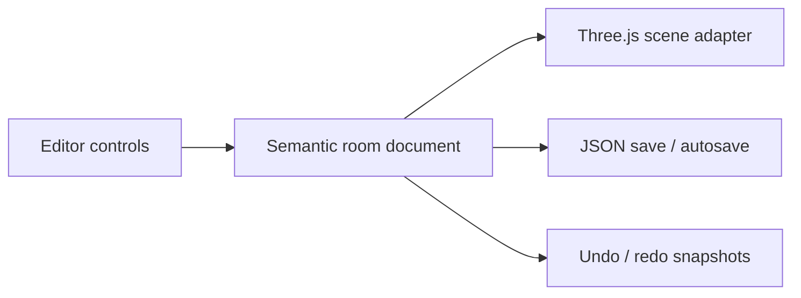

# RoomModeling

**An interactive 3D room editor with portable, versioned designs.**

Arrange furniture, change room dimensions and materials, and save a layout you can reopen and edit. Built with vanilla JavaScript and Three.js, with no build step or npm dependencies.

[Quick start](#quick-start) · [Try a sample room](#try-a-sample-room) · [Architecture](docs/architecture.md) · [Contributing](CONTRIBUTING.md)

## Highlights

- **Direct manipulation:** select, move, rotate, scale, duplicate and delete furniture with grid and rotation snapping.
- **Custom layouts:** edit room dimensions and surface colours; add chairs and box, sphere, cylinder or cone objects.
- **Portable work:** save and load JSON documents, recover autosaves, undo/redo edits and export the current view as PNG.
- **A semantic data model:** dimensions, materials and object identities survive saving independently of Three.js meshes.

## Quick start

Install Node.js 18 or newer, then:

```sh
git clone https://github.com/Coins99/RoomModeling.git
cd RoomModeling
npm start
```

Open **[http://127.0.0.1:8000/3d/](http://127.0.0.1:8000/3d/)**. There are no packages to install. The browser needs internet access to load Three.js and its controls from cdnjs and jsDelivr.

On Windows, use `npm.cmd` if PowerShell blocks `npm.ps1`. To choose another port, run `npm start -- --port 8001`.

## Try a sample room

1. Start the editor and use its **Load Scene (.json)** control to open [examples/studio.json](examples/studio.json) from your checkout.
2. Use **Orbit** mode in the Camera panel to inspect the layout. The sample has a desk, chair and low cabinet in a 6 × 5 metre room.
3. Select an object, move or rotate it, then undo the edit.
4. Save the room as JSON and load that saved file to continue editing.

The sample is a small, editable scene using the same schema as a manual save. Save your current work before loading another layout; a load replaces the open room.

## Engineering decisions



The current `schemaVersion: 2` format uses **millimetres** and a Y-up, X/Z floor plane. Object positions refer to the centre of their floor footprint. The rendering adapter converts these values to Three.js metres and mesh centres.

Imports are migrated and validated before the live scene changes. Recoverable legacy `version: "1.0"` metre-based saves are supported. Manual save, autosave and history use the same serializer. See [architecture and document conventions](docs/architecture.md) for the module boundaries and tradeoffs.

## Development

| Command | Purpose |
| --- | --- |
| `npm start` | Serve the editor on port 8000 |
| `npm start -- --port 8001` | Use a different port |
| `npm test` | Run model, migration, persistence and scene-adapter tests |

The test suite runs with Node's built-in test runner and needs no browser, CDN or package installation. GitHub Actions runs it on Windows and Linux.

| Path | Responsibility |
| --- | --- |
| `3d/app.js` | Application composition and shared editor state |
| `3d/src/model/` | Document schema, validation, migration and persistence |
| `3d/src/render/` | Semantic document ↔ Three.js adapters and object factories |
| `3d/src/features/` | Room, furniture and editor UI |
| `3d/src/systems/` | Camera, input, animation and history |
| `examples/` | Importable room documents |
| `test/` | Dependency-free automated tests |

## Status and limits

This is a working prototype under development. Automated checks cover model validation, migration, semantic round trips, coordinate conversion, scale handling and renderer reconstruction.

Browser coverage for every furniture/opening factory, rollback checks for renderer failures and repeated-load resource measurements remain open. Not every editing operation is routed through document commands. Precision placement, spatial validation and linked floor-plan/3D editing are future work.

Autosave belongs to the current browser origin; export JSON for a portable backup.

## Troubleshooting

| Symptom | Resolution |
| --- | --- |
| Blank page after opening HTML from disk | Use `npm start`; ES modules need an HTTP server |
| Three.js does not load | Check the internet connection and browser console |
| Port 8000 is occupied | Run `npm start -- --port 8001` |
| PowerShell blocks npm | Use `npm.cmd start` or `npm.cmd test` |
